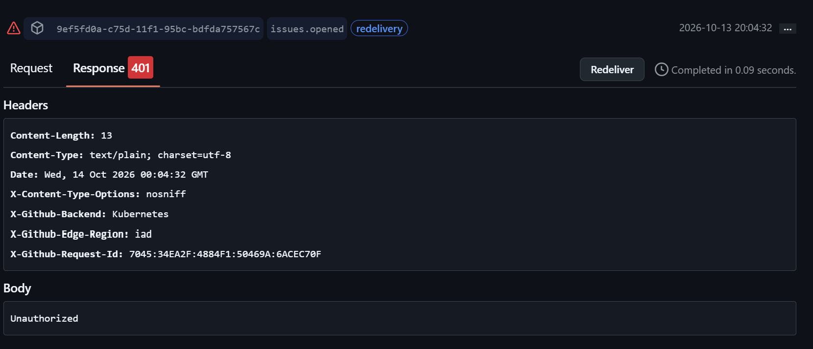

# Test Evidence – GitHub Issue Triage

## 1. Bug Issue
- **Title:** Bug: blank screen after logout
- **Body:** After logging out successfully, the application shows a blank screen instead of the sign-in page. Expected result: return to sign-in.
- **Expected Route:** Bug triage
- **Verification:** One ledger row and one bug-triage route-log row.
- **Evidence:** 

## 2. Feature Request
- **Title:** Feature request: export task list to CSV
- **Body:** Please add a CSV export so a user can download the current task list for analysis.
- **Expected Route:** Feature request
- **Verification:** One ledger row and one feature route-log row.
- **Evidence:** 

## 3. Help / Question
- **Title:** Help: change the public webhook address
- **Body:** I need guidance on updating the automation's public endpoint after moving to a new host.
- **Expected Route:** Help / Question
- **Verification:** One ledger row and one help route-log row.
- **Evidence:** 

## 4. Unclassified Issue
- **Title:** Documentation: clarify local setup
- **Body:** The setup guide should state which local port is used by the development server.
- **Expected Route:** Default / Unclassified
- **Verification:** One ledger row and the expected default-route behavior.
- **Evidence:** 

## 5. Duplicate Redelivery
- **Test:** Redeliver the original "Bug: blank screen after logout" webhook.
- **Expected Result:** The original `issue_key` remains exactly one ledger row, and no duplicate bug-triage route-log entry is created.
- **Actual Result:** Redelivery failed with a `401 Unauthorized` error in GitHub. The webhook could not be successfully redelivered, so duplicate prevention could not be verified.
- **Evidence:** 
- **Status:** Blocked – Authentication error prevented testing.
- **Status:** [Pass / Fail / Not Tested]
